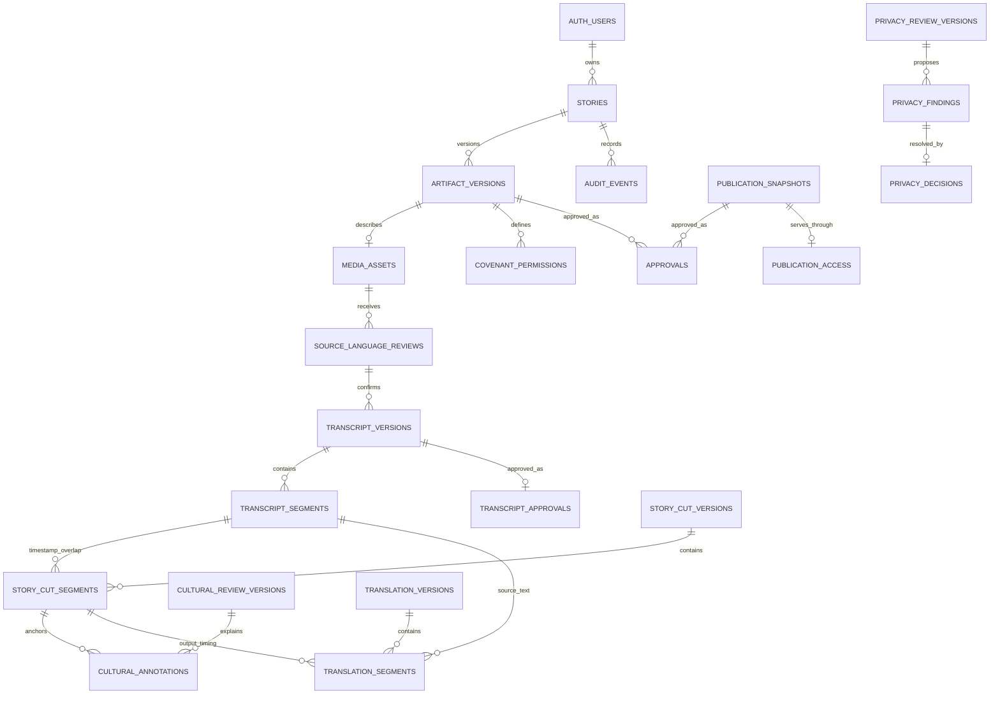

# Irin Stories MVP data model

## Scope and identity

This schema supports multiple stories per Supabase Auth user. `stories.owner_id` references `auth.users.id`, with no unique constraint on `owner_id`; one Auth user can own many stories. A child row carries `story_id` and reaches its owner through `stories`. A separate profile or password table is unnecessary for the MVP.

The foundation migration creates no Storage buckets. Follow-up migration `20261110090000_private_source_storage.sql` defines a private `private-source` bucket and owner-bound policies; it is deployed to the development project. `media_assets` stores a `bucket_id` and private `object_key`, never a permanent public URL. The follow-up migration adds the original filename and an auth-bound source registration RPC. Verify migrations `20261111090000` through `20261116090000` add server-probe evidence, source-linked language provenance, safe diagnostics, and versioned Yoruba transcription; these Verify migrations are applied to LOCAL only. `20261116090000` adds the `transcript_approvals` table. The functional MVP remains Yoruba source stories shared in English. Language columns use validated text codes so adding another supported language later does not require a structural schema change; workflow guards enforce Yoruba and English for downstream MVP work.

## Entities and relationships

The foundation migration has 20 tables; Verify B adds `transcript_approvals`. Their responsibility is split along ownership, version, cardinality, access-state, and audit boundaries:

- **Story root and shared version registry:** `stories` stores owner, title, and workflow state. `artifact_versions` gives typed story artefacts increasing per-kind version numbers, creator, SHA-256 digest, and a one-time seal timestamp.
- **Source and language confirmation:** `media_assets` stores source or final media metadata. `source_language_reviews` preserves each proposal and the storyteller's confirmation/correction; `storyteller_language_decisions` preserves direct storyteller selection and confirmation. `transcript_versions` binds one of those exact language confirmations and a source version; `transcript_segments` stores the AI-original Yoruba text, current storyteller-edited text, source-media ID, and bounded source timestamps. A new `transcript_approvals` row binds the owner's approval to the sealed transcript artifact SHA-256.
- **Craft and cultural review:** `story_cut_versions` binds the approved source/transcript pair. `story_cut_segments` stores each source-video interval, output interval, narrative role, rationale, and decision. A trigger requires each interval to overlap a segment in the exact transcript version. The overlap is derived from timestamps, so a separate cut-to-transcript junction table is unnecessary. `cultural_review_versions` and `cultural_annotations` keep versioned cultural review and one-or-more storyteller explanations for expressions in specific cut segments.
- **Translation:** `translation_versions` binds Yoruba source, exact transcript, Story Cut, and cultural-review versions. `translation_segments` references both the exact transcript segment and exact cut segment. Composite foreign keys keep them on the same story, source media, transcript version, and Story Cut; a trigger checks that the source transcript interval overlaps the selected cut segment. Subtitles use the cut output timeline.
- **Privacy:** `privacy_review_versions` binds a review to the exact approved cut and translation. `privacy_findings` stores potential concerns and a source/timestamp, transcript, cut, or translation anchor. `privacy_decisions` is a separate storyteller-only, append-only choice. `KEEP` has no edit version; `GENERALISE`, `ANONYMISE`, and `REMOVE` must cite a later approved Story Cut or translation version with the same source-media/transcript ancestry as the finding. A new privacy review must approve the edited content before publication.
- **Permissions and approvals:** a Covenant is an `artifact_versions` row of kind `COVENANT`, with one `covenant_permissions` row for each of ten explicit permissions. Defaults deny; publication requires the active Covenant to explicitly allow `PUBLIC_VIEWING`. Voice cloning cannot be enabled. `approvals` bind a human decision and 32-byte SHA-256 digest to exactly one sealed artefact version or publication snapshot.
- **Publication and history:** `publication_snapshots` is the immutable typed manifest of exact source, transcript, cut, cultural review, translation, privacy review, Covenant, and final-media versions, including disclosure flags and a manifest hash. Final media metadata is a `media_assets` row with `role = FINAL_PUBLICATION` and exact cut/translation lineage; a wrapper table is not needed. `publication_access` holds mutable serving state outside the immutable snapshot. `audit_events` records append-only events without copying private text or storage paths.

## Relationship diagram



Composite foreign keys repeat `story_id` intentionally. They reject cross-story references and bind child rows to exact versions. The diagram abbreviates some specialized version relationships for readability.

## Workflow states and version invalidation

`story_workflow_state` is a PostgreSQL enum containing the requested finite state set: `DRAFT`, `MEDIA_READY`, `LANGUAGE_CONFIRMATION`, `TRANSCRIBING`, `SOURCE_REVIEW`, `SOURCE_APPROVED`, `CRAFTING`, `CRAFT_REVIEW`, `CRAFT_APPROVED`, `TRANSLATING`, `TRANSLATION_REVIEW`, `TRANSLATION_APPROVED`, `PRIVACY_REVIEW`, `COVENANT_REVIEW`, `PUBLICATION_REVIEW`, `PUBLISHED`, and `WITHDRAWN`. Unknown states fail at the database boundary; adding future states requires an explicit migration.

The main forward path is:

```text
DRAFT -> MEDIA_READY -> LANGUAGE_CONFIRMATION -> TRANSCRIBING -> SOURCE_REVIEW
-> SOURCE_APPROVED -> CRAFTING -> CRAFT_REVIEW -> CRAFT_APPROVED
-> TRANSLATING -> TRANSLATION_REVIEW -> TRANSLATION_APPROVED
-> PRIVACY_REVIEW -> COVENANT_REVIEW -> PUBLICATION_REVIEW -> PUBLISHED -> WITHDRAWN
```

Rework creates a new artefact version. Historical approvals stay attached to their old target and hash; `artifact_is_latest_approved` checks dependencies before treating an approval as current. Sealing a new version changes the workflow to its affected review stage and changes any active publication access to `STALE` in the same transaction. Per-story row locks serialize artefact, language-review, and publication-snapshot version allocation. Unique constraints still fail closed if a competing workflow bypasses the lock discipline.

`publication_access`, not the story workflow label alone, controls whether a publication may be served. A publication snapshot is immutable and its access record is a separate, constrained state machine.

## Media verification, language review, and duration rules

`source_media_verifications` is append-only and references the exact registered source artifact. The server downloads that object only after checking the authenticated user's story ownership and signing the database-loaded object key for five minutes. FFprobe records actual container/formats, duration, video/audio presence and codecs, dimensions, and a server SHA-256. A bounded FFmpeg decode verifies that the audio stream is decodable. Client-reported duration, byte size, MIME/container, and checksum are compared and material mismatches are stored; reported values are not silently overwritten. A READY result requires video and decodable audio. Unsupported/corrupt audio is recorded REJECTED. The 5–15-minute duration is guidance rather than a DB constraint.

Language codes are text with a generic language-tag format check. The provider boundary uses a strict Zod result contract with a nullable confidence; null is required when the provider does not supply a defensible confidence. Proposals and storyteller decisions are append-only records tied to the exact source media artifact. The storyteller decision function derives identity from `auth.uid()` and only accepts the current story source and a proposal for that same source. A new source invalidates prior applicability while preserving historical rows. Only latest owner-confirmed `yor` on the current READY source is eligible for transcription; both AI-confirmed proposals and direct storyteller-selected decisions are valid evidence. Verify B stores each transcript as a sealed `TRANSCRIPT` artifact version with source timestamps. AI text remains in `initial_proposal`; storyteller corrections create a new artifact version and preserve that original field. `transcript_approvals` records the owning storyteller, server timestamp, and exact artifact digest. Edits never mutate historical versions, and approvals for older transcript/source versions remain historical but are not applicable to the current version.

The replaceable language provider interface currently has an OpenAI adapter for `gpt-transcribe`. It consumes only OpenAI's detected language list and safe request ID; transcription text is discarded. The application still returns a retryable unavailable state when `OPENAI_API_KEY` is absent. Provider confidence is null because this endpoint does not provide a defensible language confidence. The local integration harness exercises proposal/decision database behavior using clearly synthetic trusted provider fixtures; that does not establish real-world detection accuracy.

Database duration checks are general integrity constraints: media and cut durations must be positive; segment end must exceed segment start; timestamps cannot exceed the referenced source media or cut timeline. The recommended hackathon UX guidance remains a 5-15-minute source video and a 90-150-second Story Cut/publication. The server and client should validate these demo ranges, but the database does not enforce them as permanent limits.

## Storage keys and private media

No Storage bucket is created by this migration. `media_assets.bucket_id` and `media_assets.object_key` store storage identifiers rather than public URLs; the object-key constraint rejects URL-shaped values. Suggested future paths are:

- source: `private-source/{owner_id}/{story_id}/{media_artifact_id}/source.ext`
- derived private media: `private-derived/{owner_id}/{story_id}/{artifact_id}/...`
- final publication media: `publications/{publication_public_id}/{snapshot_version}/...`

The Auth/Storage migration creates only the `private-source` bucket. Source keys use `{owner_id}/{story_id}/{media_id}/{sanitized_filename}`; Storage policies bind the first folder to `auth.uid()` and the second folder to an owned story. Reads require an authenticated matching owner. Cleanup DELETE is limited to unregistered uploads; registered source metadata and objects are append-only through the client policy. The Tell playback URL lasts one hour; Verify's server retrieval URL lasts five minutes. Both are temporary bearer URLs until expiry. Future derived and final-publication objects require separately designed access controls. No database row stores a permanent public URL.

Authenticated story creation runs through `public.create_story()`, which supplies `owner_id` from `auth.uid()` and exposes no owner parameter. Source registration runs through `public.register_source_media(...)`, which validates the authenticated owner, story, bucket path, upload metadata, and Storage object owner before sealing the SOURCE_MEDIA artifact. The database audit trigger records registration. Client-supplied `owner_id` is never used by the app.

## Approvals, privacy, and Covenant

`approvals` has two nullable target FKs, a database `CHECK (num_nonnulls(artifact_version_id, publication_snapshot_id) = 1)`, and a separate FK for each target. This bounded polymorphic form is safe here: exactly one target is mandatory, each target must exist in the same story, and unique constraints prevent duplicate decisions for a version/snapshot. The approval trigger requires the approver to equal the story owner, the artefact to be sealed, and the supplied 32-byte hash to match the exact version. Publication approvals bind to the immutable manifest hash. Approval rows cannot be updated or deleted.

AI may propose privacy findings, but cannot resolve them. A storyteller decision is required for each finding in the review being published. Non-KEEP decisions cite a later approved edit version; a subsequent privacy review must still approve the edited cut/translation. `REMOVE` applies to derived/public content and never deletes source media or provenance.

Covenant permissions are versioned and privacy-protective. All ten permissions must be present; absent values cannot silently become allowed. `VOICE_CLONING = true` is rejected. An active Covenant is the latest approved Covenant version. Publishing and public lookup both require explicit `PUBLIC_VIEWING = true` on the active Covenant.

## Publication, public reads, and withdrawal

`publication_snapshots` stores the exact approved source media, transcript, Story Cut, cultural review, English translation, privacy review, Covenant, and final rendered-media artefact. Composite FKs preserve lineage within one story; the manifest SHA-256 and snapshot rows are immutable. A trusted server must calculate the canonical digest and perform the approval and publish transitions transactionally; PostgreSQL checks digest length and equality but does not compute the canonical application hash.

There is no anonymous-readable view. `public.get_published_story(uuid)` is a narrow `SECURITY DEFINER` RPC because PostgreSQL views normally run with their owner's privileges and could bypass base-table RLS. The function has an empty fixed `search_path`, schema-qualifies every object, is executable only by `anon` and `authenticated`, and returns only public ID, title, language codes, AI disclosure flags, and publish time. It requires an exact approved manifest hash; `PUBLISHED` access and story state; the latest snapshot; the active Covenant with explicit public viewing; and successful full snapshot validation. It returns no owner ID, storage key, transcript, privacy finding, or Covenant field. Anonymous and authenticated clients have no base-table grant for private records.

Withdrawal changes only `publication_access` and story state. It removes the record from the public RPC and future media-serving checks, while snapshots, private media metadata, approvals, and audit events remain available to the owner and authorized server workflow. It cannot recall previously downloaded copies.

## Row Level Security and remaining work

RLS is enabled on all 20 tables. Private child tables scope authenticated `SELECT` through `irin_private.user_owns_story(story_id)`, a narrowly granted `SECURITY DEFINER` ownership helper that compares the story owner with `auth.uid()`. `stories` uses `owner_id = auth.uid()` directly. No authenticated insert accepts an unchecked owner ID. Authenticated storytellers can insert only their own privacy decisions and approvals; they can only change a published access row to withdrawn. Most artefact writes occur in trusted server workflows because authenticated clients have no write grants for those tables. `service_role` bypasses RLS and must remain server-side; triggers and constraints still enforce version, ownership, approval, and lineage rules. No base table grants access to `anon`.

Before implementation, add transaction-oriented server operations for sealing and approvals, enforce canonical hashing, and complete the remaining local RLS and publication tests listed in `docs/local-database-test-report.md`. Before any publication feature, add private Storage policies for each object class and test every public page/media/subtitle request after withdrawal. Further local execution validation remains required before any separately authorized remote migration push.

Local replay was subsequently confirmed by catalog query on 2026-11-10 (20 public tables; RLS enabled on all 20). Runtime verification of cross-story lineage, approval integrity, a full valid synthetic publication, actual RPC output, and withdrawal retention remains open; see `docs/local-database-test-report.md`.

The requested cross-story, approval-integrity, valid-publication/RPC, and withdrawal tests remain runtime-unverified. Current local DB has no synthetic users or stories. Do not treat the composite constraints, target check, trigger definitions, or RPC return declaration as proof of those behaviors; see `docs/local-database-test-report.md`.

## Local runtime integration evidence

The repeatable rollback-only synthetic harness at `supabase/tests/irin_stories_foundation_test.sql` executed twice against the local PostgreSQL database. It passed cross-story lineage and approval-integrity rejection cases, created and returned one complete publication through the anonymous RPC with exactly seven public fields, then verified withdrawal removed public visibility while private snapshot, approvals, Covenant, source lineage, and audit history remained. The full result matrix and database errors are in `docs/local-database-test-report.md`. No production migration change was needed.
## Local diagnostic hardening — 2026-11-11

Follow-up migration 20261114090000_harden_verify_language_diagnostics.sql preserves applied history. Both diagnostic migrations are local-only. The fourteen columns are: correlation_id UUID primary key; story_id nullable UUID foreign key; attempted_at non-null timestamptz; stage/category non-null allowlisted text; retryable non-null boolean; provider/model nullable allowlisted text; provider_http_status nullable smallint (100–599); provider_error_type/code nullable exact allowlisted text (maximum 64); provider_request_id nullable req_ plus 32 hexadecimal digits; transport nullable timeout/network; database_code nullable five uppercase alphanumeric SQLSTATE characters. Null story IDs are allowed only at ownership_check. Diagnostics cascade on story deletion, replacing SET NULL to prevent invalid orphans.

Strict Zod validation precedes inserts. Unknown provider types/codes become null; PGRST codes become null because they are not SQLSTATEs. Browser failure fields are unchanged. No generic payload, JSON, message, transcript, audio, path or URL column exists.

The local SQL matrix rejected 92 forbidden insertions: paragraphs, key-like sentinels, bearer text, URLs, Windows/Unix paths, signed URLs, oversized identifiers and JSON across all nine text fields, invalid HTTP statuses/SQLSTATEs, and missing resolved story IDs. Service insertion/read and RLS/grants passed. Tests roll back. The existing Verify SQL harness reported 19 passing assertions and deliberately raised its results exception for rollback.

Four real-database GET handler cases passed: owner 200; cross-owner, anonymous and unknown reference 404. Session identity and database-client adapters are injected; full browser-cookie/HTTP authentication is not claimed. Run diagnostics-local.test.ts with VERIFY_DIAGNOSTICS_DB_TEST=1 and --testTimeout=30000 --hookTimeout=30000. Fixtures are removed.

All six application migrations replayed in an isolated local database over empty auth/storage platform definitions with required primary keys. The rejection matrix passed there; the scratch database was removed. No reset of the existing local database was needed.

Limits: constraints cannot prevent covert encoding into valid UUIDs, hexadecimal request IDs or SQLSTATE-shaped identifiers, or a privileged administrator changing constraints. Database outages can still prevent durable writes. No hosted changes, live OpenAI requests or commits occurred.
## Human language selection provenance

`storyteller_language_decisions` records direct human language choices independently from AI proposal review rows. Its constrained origin distinguishes `ai_proposal_confirmed`, `storyteller_selected`, and `storyteller_corrected`; the fallback uses only `storyteller_selected` and has no proposal FK. A selected row has state `selected` and null `confirmed_by`/`confirmed_at`. The separate owner-only confirmation RPC changes that row to `confirmed` and generates the timestamp server-side. Eligibility requires confirmed Yoruba for the latest current source and a latest READY media verification. Selecting alone cannot unlock eligibility. Detection failure records remain in the diagnostics and audit history.
